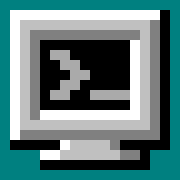
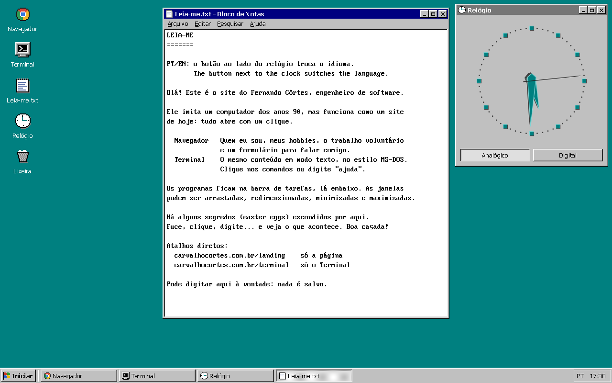
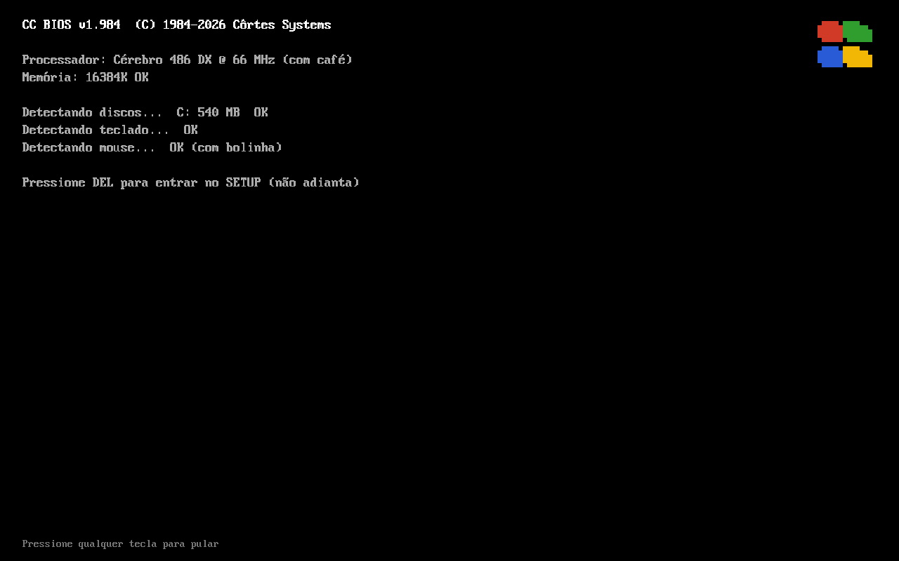
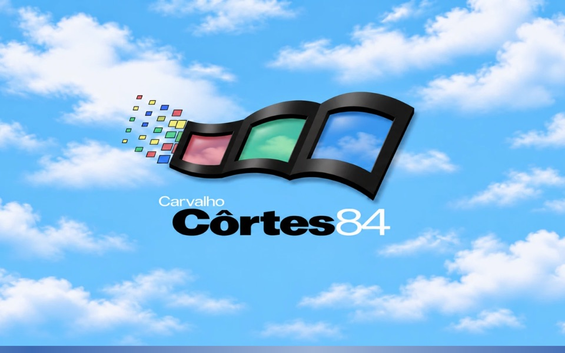

<div align="center">



# CarvalhoCortes 84

**O portfólio do Fernando Côrtes, num computador dos anos 90 que roda no navegador.**

[carvalhocortes.com.br](https://carvalhocortes.com.br)

[](https://github.com/carvalhocortes/portifolio-personal-website/actions/workflows/deploy-pages.yml)



</div>

> [!NOTE]
> **Versão 2 pronta** (novembro de 2026): o desktop dos anos 90, com todos os programas, está no ar. A versão
> anterior, só com o terminal, está na branch [`v1`](https://github.com/carvalhocortes/portifolio-personal-website/tree/v1).

O site liga como um PC antigo (BIOS, DOS e tela com logo) e abre um desktop com janelas, ícones, menu Iniciar e
barra de tarefas. Cada programa mostra uma parte do portfólio. O visual é dos anos 90, mas o uso é de hoje: tudo
abre com um clique, com links e rolagem normais. No celular, o site abre direto numa landing page moderna.

| Abertura | Tela com logo | Celular |
| :---: | :---: | :---: |
|  |  |  |

## Programas e endereços

| Programa | O que mostra |
| --- | --- |
| Navegador | A landing page, numa janela com barra de endereço decorativa |
| Terminal | O mesmo conteúdo em modo texto; digite `ajuda` (ou `help`) para ver os comandos |
| Leia-me.txt | O que é o site e como usar; dá para digitar, mas nada é salvo |
| Relógio | A hora em modo analógico ou digital, com a data no idioma do site |
| Paciência | O jogo de cartas clássico: arraste as cartas ou clique numa delas para a jogada automática |
| Lixeira | Projetos que quase entraram no site, uma pasta por projeto |
| ICQ | Mensagens para o Fernando, o único online; a mensagem chega por e-mail (com captcha). Também abre pela flor ao lado do relógio |

| Endereço | Abre |
| --- | --- |
| [`/`](https://carvalhocortes.com.br) | O desktop (no celular, a landing page) |
| [`/landing`](https://carvalhocortes.com.br/landing) | Só a landing page |
| [`/terminal`](https://carvalhocortes.com.br/terminal) | Só o Terminal, em tela cheia |

## Editar o conteúdo

Textos e dados ficam separados, com um arquivo de textos por idioma:

- **Textos** (conteúdo e interface): [`src/shared/i18n/locales/pt-BR.yaml`](src/shared/i18n/locales/pt-BR.yaml) e
  [`en-US.yaml`](src/shared/i18n/locales/en-US.yaml), com as mesmas chaves nos dois.
- **Dados que não mudam com o idioma** (nome, datas, contato, fotos, links e ordem dos itens):
  [`content/site.yaml`](content/site.yaml).

O texto fica no mesmo caminho do dado: o título do hobby `marcenaria` é `hobbies.itens.marcenaria.titulo`, e o
nome da pasta `exemplo` da Lixeira é `lixeira.pastas.exemplo.nome`. As imagens ficam em `public/resources/`; cada foto de hobby também tem uma versão pequena (320 px, JPEG) em
`public/resources/thumbs/`, com o mesmo nome, usada na faixa de fotos do topo da landing.

> [!TIP]
> Os testes falham se uma chave faltar num idioma, se um texto ficar vazio, se faltar o texto de algum item dos
> dados ou se uma imagem citada não existir. Rode `npm test` depois de editar.

O site abre no idioma do navegador (português para quem não usa inglês) e lembra a escolha feita no PT/EN.

## Para desenvolver

Precisa de Node.js 20 ou mais novo.

```bash
npm install
npm run dev        # http://localhost:5173
```

| Comando | Faz |
| --- | --- |
| `npm run dev` | Servidor de desenvolvimento |
| `npm test` | Testes (Vitest e Testing Library) |
| `npm run lint` | ESLint |
| `npm run format` | Prettier |
| `npm run build` | Checagem de tipos e build de produção em `dist/` |
| `npm run preview` | Serve o build localmente |
| `cd e2e && uv run pytest` | Testes de ponta a ponta (Playwright, em Python); veja [`e2e/README.md`](e2e/README.md) |

**Tecnologias:** React, TypeScript, Vite, i18next, Vitest e Testing Library; Playwright e pytest nos testes de
ponta a ponta. A landing page usa a fonte Geist e
ícones Phosphor; o formulário de contato envia pelo [Web3Forms](https://web3forms.com) com hCaptcha.

**Estrutura** ([Feature-Sliced Design](https://feature-sliced.design)):

```
content/site.yaml        dados do site (fotos, links, datas)
src/
  app/                   estilos globais e rotas
  pages/                 DesktopPage, LandingPage e TerminalPage
  widgets/               Desktop, Taskbar, Browser, Terminal, Notepad, ClockApp, RecycleBin, BootScreen, Landing
  features/              WindowManager e entrada de comandos
  entities/              Content (dados) e Program (definição dos programas)
  shared/                i18n (textos), ícones em pixel art e utilitários
public/resources/        imagens
e2e/                     testes de ponta a ponta (Playwright + pytest)
docs/                    capturas de tela deste README
```

**Deploy:** cada push na `main` roda o workflow
[`deploy-pages.yml`](.github/workflows/deploy-pages.yml), que testa, gera o build e publica no GitHub Pages, no
domínio `carvalhocortes.com.br` (arquivo `public/CNAME`). O histórico de mudanças está no
[CHANGELOG](CHANGELOG.md).

## Créditos

A fonte **Px437 IBM VGA 8x16** vem do [Ultimate Oldschool PC Font Pack](https://int10h.org/oldschool-pc-fonts/), de
VileR, sob a licença [CC BY-SA 4.0](https://creativecommons.org/licenses/by-sa/4.0/)
(`public/fonts/LICENSE-oldschool-pc-fonts.txt`). Logos e ícones são desenhos próprios, sem marcas de terceiros.

O código está sob a licença MIT ([LICENSE](LICENSE)). O conteúdo pessoal (textos e fotos) e as imagens próprias não
entram nessa licença.
